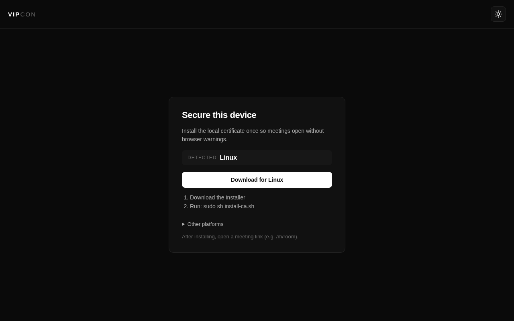

# Vipcon — Private, Self-Hosted Video Conference Appliance

A **security-first** video conferencing device built for **confidential, mission-critical,
and exclusive meetings** — negotiations, boardrooms, legal counsel, and any conversation
where privacy is non-negotiable and data must never leave your network.

Every layer — signaling, media, and meeting data — runs entirely on a single low-power
**edge SBC** inside your own infrastructure. No cloud, no third party, no data outside
your control.

---

## Why Vipcon

- **Private by design** — signaling, media, and meeting data never leave your network;
  you own the hardware end-to-end.
- **Air-gapped capable** — fully functional offline, with zero internet dependency.
- **No third-party cloud** — nothing is routed through external infrastructure.
- **Controlled access** — passcode, lobby, and host moderation decide exactly who joins.
- **No recording, no media storage** — audio, video, and chat are relayed in real time
  and never persisted. Only minimal meeting metadata (accounts, schedule, passcodes)
  is kept locally on the device.

## Features

- **Local-first** — full video meetings on your LAN, even with zero internet.
- **Offline HTTPS** — per-device private CA with one-click install
  (Windows · macOS · Linux · iOS · Android). No certificate warnings.
- **Host moderation** — lobby (admit / reject), mute, and kick participants.
- **Meeting management** — schedule, passcode, invitation links, and up to
  **5 concurrent meetings** per device.
- **User management** — up to **20 accounts**.
- **Screen share** — presenter view with fullscreen + circular camera PiP.
- **Chat** — data-channel chat with unread badge and notification sounds.
- **Dark / light theme** — monochrome, clean, minimal.

## Screenshot



## Architecture

```
                       ┌──────────────────────────────────────────┐
                       │        Edge SBC (the device)             │
                       │                                          │
   LAN clients ───────▶│  Caddy (HTTPS :443, local CA)            │
   (browsers)          │    ├─ /          → static web UI (React) │
                       │    ├─ /api/*     → app  (FastAPI + SQLite)│
                       │    └─ /rtc*      → LiveKit (signaling)    │
                       │                                          │
                       │  LiveKit server  → media UDP/TCP :7881/82 │
                       │  dnsmasq         → local DNS (host.lan)   │
                       │  agent           → heartbeat + license    │
                       └──────────────────────────────────────────┘
```

**Signaling and media are separate:**

- *Signaling* (join, chat, moderation, screen-share control) flows over
  **WebSocket → Caddy → LiveKit**.
- *Media* (audio/video) flows **peer-to-peer over UDP** directly between
  participants (same LAN), or via a **TURN** server for cross-internet calls.

## How a meeting works

1. **Claim** — scan the device QR to create the first admin account.
2. **Create** — host opens the dashboard (`/admin`), creates a meeting with
   schedule, passcode, and lobby.
3. **Invite** — share the invite link (LAN or internet domain).
4. **Join** — participants join via `/m/<room>`; if lobby is on, the host
   admits them.
5. **Moderate** — host can mute / kick / admit from the People panel.

## Tech stack

| Layer | Technology |
|---|---|
| Media server | LiveKit (Go SFU) |
| Device app | FastAPI + SQLite + PyJWT |
| Control plane | FastAPI + SQLAlchemy (Postgres/SQLite) |
| Web UI | React 19 + Vite + livekit-client |
| Reverse proxy / TLS | Caddy (private CA + Cloudflare DNS plugin) |
| Local DNS | dnsmasq |
| Provisioning | systemd + first-boot script |

## Repository layout

```
control-plane/   Super-admin control plane (Tencent cloud side)
device/
  app/           FastAPI dashboard + token issuer + moderation
  agent/         Heartbeat + license agent
  web/           React meeting UI + dashboard
  livekit/       LiveKit config template
  caddy/         Caddyfile templates + Dockerfile
  dnsmasq/       Local DNS template
  provisioning/  First-boot + CA generation scripts
  systemd/       Appliance service
docs/            Documentation + screenshots
image-builder/   Golden image build
```

## Quick start (development)

```bash
# Run LiveKit
docker run --rm --network host \
  -v $PWD/device/livekit/livekit.yaml:/etc/livekit.yaml:ro \
  livekit/livekit-server:v1.13.11 --config /etc/livekit.yaml

# Run the device app
cd device/app
pip install -r requirements.txt
DATABASE_URL=sqlite:////tmp/app.db SESSION_SECRET=dev \
  uvicorn main:app --host 0.0.0.0 --port 8000

# Build & run the web UI
cd device/web
npm install
npm run dev
```

## License

Apache-2.0 (LiveKit is Apache-2.0; application code is your own).
